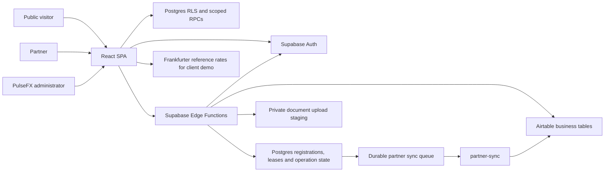

# PulseFX portals

PulseFX combines an authenticated partner portal, an internal administration portal, a public referral intake form, and client/partner demonstrations in one React application. Supabase provides authentication, access control, server-side operations and synchronization state. Airtable stores partner business records, referrals, banking submissions, payout records, documents and support requests.

The partner and administration features have backend integrations. The client portal is a demonstration: it does not execute payments, trades, forward drawdowns or financing requests. Payout administration records payments arranged outside the application; it does not transfer money.

This guide describes the source in this repository as reviewed on November 17, 2026. It does not certify the configuration or deployment status of a hosted environment.

## Contents

- [Architecture and technology](#architecture-and-technology)
- [Repository map](#repository-map)
- [Portals, roles and routes](#portals-roles-and-routes)
- [Local development](#local-development)
- [Configuration](#configuration)
- [Authentication and account lifecycle](#authentication-and-account-lifecycle)
- [Feature flows](#feature-flows)
- [Edge Function inventory](#edge-function-inventory)
- [Airtable data contracts](#airtable-data-contracts)
- [Database dependencies](#database-dependencies)
- [Validation](#validation)
- [Deployment](#deployment)
- [Operations and troubleshooting](#operations-and-troubleshooting)
- [Scope and limitations](#scope-and-limitations)

## Architecture and technology



| Layer | Implementation | Responsibility |
| --- | --- | --- |
| Browser application | React 19, React Router 7, Vite 8 | Portal entry, routes, forms, tables, filters and downloads |
| Styling and icons | Tailwind CSS 4, Lucide React, shared CSS/SVG assets | Layout, branding and interface components |
| Authentication | `@supabase/supabase-js` 2 | Email/password login, sessions, invitation and recovery verification |
| Access and coordination | Supabase Postgres, RLS, RPCs | Membership, account provisioning, session checks, leases, audit and retries |
| Server API | Supabase Edge Functions; TypeScript entry points and JavaScript modules | Authorization, validation and upstream integration |
| Business data | Airtable | Partners, referrals, banking, payouts, content and operational email queues |
| File staging | Supabase Storage and Airtable attachments | Document ingestion and final attachments |
| Automated checks | ESLint, Node test runner, Vite SSR builds, LinkeDOM, SQL scripts | Domain checks, UI behavior and database access rules |
| Frontend delivery | GitHub Actions and GitHub Pages | Build and static-site deployment |

Supabase is the authority for access. Changing a partner's Airtable account status does not grant or revoke portal permissions. The browser receives public Supabase configuration and user sessions; Airtable credentials and Supabase service-role credentials remain in server functions.

## Repository map

```text
.
├── src/
│   ├── main.jsx                  # React bootstrap
│   ├── App.jsx                   # BrowserRouter and global keyboard navigation
│   ├── AppRoutes.jsx             # Portal routes, legacy links and public entry
│   ├── ClientApp.jsx             # Client demonstration; state-based screen switching
│   ├── components/               # Partner, administration and client screens
│   ├── lib/                      # API clients, access flows and shared utilities
│   ├── assets/                   # Bundled logos and artwork
│   ├── App.css
│   └── index.css
├── supabase/
│   ├── config.toml               # Edge Function gateway configuration
│   ├── functions/
│   │   ├── _shared/              # Membership, admin session, audit and validation modules
│   │   └── <function>/            # index.ts, service modules and domain tests
│   ├── migrations/              # Referral submission gate migration only
│   └── tests/                   # SQL checks for the existing database schema
├── tests/                       # Keyboard and public referral form UI tests
├── public/                      # Static assets, sample one-pagers and SPA 404 fallback
├── .github/workflows/portal.yml  # CI and GitHub Pages publishing
├── vite.config.js
├── eslint.config.js
├── package.json
└── package-lock.json
```

The main partner shell is [`PartnerPortal.jsx`](src/components/PartnerPortal.jsx), protected by [`PartnerSession.jsx`](src/components/PartnerSession.jsx). Domain API clients live in `src/lib`, including `referrals.js`, `referralForm.js`, `partnerAdmin.js`, `pulsefxUserAdmin.js`, `banking.js`, `payouts.js`, `documents.js`, `brandKit.js`, `brandAssets.js`, `onePagers.js`, `support.js` and `passwordRecovery.js`.

Cross-cutting utilities cover Toronto date handling, payout arithmetic, sorting, pagination, focus management, dialogs, keyboard navigation and session inactivity. Public partner sample records are defined in `src/lib/partnerDemo.js` and the partner shell.

## Portals, roles and routes

Routes below are relative to the configured Vite base path.

| Route | Audience | Behavior |
| --- | --- | --- |
| `/` | Public | Portal selection and sign-in entry |
| `/?ref=<signed-token>` | Public | Partner-specific referral form |
| `/?token_hash=...&type=...` | Invitation/recovery recipient | Access-link verification and password setup |
| `/pulseFx` | Public | Additional entry route retained in the router |
| `/partner/sign-in` | Public | Partner sign-in; can return to the requested partner route |
| `/partner/:page?` | Authenticated | Partner or administration shell, according to verified access |
| `/demo/:page?` | Public | Partner demonstration without backend submissions |
| `/client` | Public | Client demonstration |
| Unmatched route | Public | Page-not-found screen |

Partner pages: `home`, `referrals`, `add`, `banking`, `payouts`, `brand`, `guide` and `contact`. Home shows referral totals and the personal referral URL. Other pages cover referral registration/tracking, bank submissions, payout history, partner branding, shared resources and support.

Administration pages: `admin` (User management), `banking-approvals`, `admin-payouts`, `admin-referrals` and `documents`. Administrators use a separate navigation menu; their role alone does not grant a partner membership.

Legacy hashes `#partner`, `#partner-admin` and `#partner-admin-demo` redirect to `/partner` and require authentication. `#partner-demo` redirects to `/demo`. There is no public administration demo.

The client demonstration switches screens with React state inside `/client`: Dashboard, Move Money, Beneficiaries, Holding/Linked Accounts, Forwards, Trade Finance, Reports, Profile, Security and Help & support. Its screen names are not independent router paths.

## Local development

Use Node.js 24 to match CI and npm with the committed lockfile. Supabase CLI and access to the intended Supabase/Airtable environment are needed for backend deployment and live integration checks, but not for browsing public demos.

```sh
npm ci
npm run dev
```

Open the address printed by Vite, usually `http://localhost:5173`.

For authenticated features, create `.env.local` in the repository root:

```dotenv
VITE_SUPABASE_URL=https://YOUR_PROJECT_REF.supabase.co
VITE_SUPABASE_PUBLISHABLE_KEY=YOUR_PUBLIC_PUBLISHABLE_KEY
```

Restart Vite after changing environment variables. These values are embedded in production builds; changing deployment variables requires rebuilding the frontend. Without both values, partner sign-in reports that it is not configured. Public demonstrations remain available.

```sh
npm run build
npm run preview
```

`build` writes static output to `dist/`; `preview` serves that build locally. Generated `dist/`, `dist-ssr/`, `node_modules/` and local environment files are ignored by Git. There is no complete local Supabase/database bootstrap in this repository; see [Database dependencies](#database-dependencies) before attempting a fresh installation.

## Configuration

### Public frontend variables

| Variable | Purpose |
| --- | --- |
| `VITE_SUPABASE_URL` | Target Supabase project URL |
| `VITE_SUPABASE_PUBLISHABLE_KEY` | Public key for browser Auth, RLS and function calls |

Never add `VITE_` prefixes to server credentials. Do not put an Airtable token, service-role key, sync secret or referral signing secret in browser configuration.

### Edge Function environment

Configure these in the target Supabase project's Edge Function secrets as required by the functions being deployed.

| Variable | Purpose / consumers |
| --- | --- |
| `SUPABASE_URL` | Supabase API URL; supplied by the hosted runtime |
| `SUPABASE_ANON_KEY` / `SUPABASE_PUBLISHABLE_KEY` | Public API credential for Auth verification and caller-scoped membership lookups; readers prefer the publishable key where supported |
| `SUPABASE_SERVICE_ROLE_KEY` | Server-only Auth administration, leases, operation state and Storage administration; supplied by the hosted runtime |
| `AIRTABLE_TOKEN` | Personal access token with record permissions for the configured base/tables |
| `AIRTABLE_BASE_ID` | Airtable base ID (`app...`) |
| `AIRTABLE_PARTNERS_TABLE_ID` | Shared partner table; configure explicitly because fallback names differ between handlers; the sync worker requires a table ID |
| `AIRTABLE_REFERRALS_TABLE_ID` | Referral table; required by the referral reader and public form, also used for payout client options |
| `AIRTABLE_REFERRAL_FORM_TABLE_ID` | Full referral intake table; used by public submission and authenticated referral details |
| `AIRTABLE_BANKING_TABLE_ID` | Banking table override; default `Banking_details_api` |
| `AIRTABLE_PAYOUTS_TABLE_ID` | Payout table override; default `Payouts_api` |
| `AIRTABLE_BRAND_KIT_TABLE_ID` | Partner-owned branding; default `Brand_kit_api` |
| `AIRTABLE_BRAND_ASSETS_TABLE_ID` | Shared PulseFX brand assets; required by content readers/admin |
| `AIRTABLE_ONE_PAGERS_TABLE_ID` | Partner guide resources; required by content readers/admin |
| `AIRTABLE_SUPPORT_TABLE_ID` | Partner and public login support requests |
| `AIRTABLE_RECOVERY_TABLE_ID` | Public password recovery email queue |
| `AIRTABLE_PARTNER_INVITATIONS_TABLE_ID` | New-partner invitation email queue |
| `PORTAL_URL` | Full canonical frontend URL, including any base path, used for access links and public referral URLs |
| `PARTNER_SYNC_SECRET` | Dedicated server credential for the synchronization worker |
| `PARTNER_REFERRAL_LINK_SECRET` | HMAC signing secret for public referral URLs; at least 32 characters |

Use explicit table IDs for a shared environment instead of relying on legacy `Partners`/`Partners_api` or `Referrals_api` fallback names. IDs in this document are placeholders, not a record of live infrastructure.

The Airtable PAT needs `data.records:read` and, for write features, `data.records:write` access to the intended tables. The application does not create Airtable schemas; configure fields and select options separately. Partner synchronization also expects Vault entries `partner_sync_secret` and `partner_sync_project_url`, plus the database dispatch/cron infrastructure.

## Authentication and account lifecycle

### Access checks

Partner login uses Supabase email/password authentication. The application verifies the live Auth user and resolves enabled `public.partner_memberships` access through RLS. The membership's `partner_id` is an Airtable partner record ID (`rec...`), not an Auth UUID, registration UUID or arbitrary label.

Only server-managed `app_metadata.role = partner_admin` grants administration. Email matching and user-editable metadata do not grant this role. Administrative handlers also validate the current Auth session; revoked sessions must not continue managing accounts or approving records.

Disable public signup and anonymous sign-in in the target Auth project. Provision the first administrator through a trusted Auth Admin operation, preserving unrelated app metadata. Configure the portal URL in Auth redirect settings and choose the project's password policy and link expiration settings.

Browser sessions use a project-specific storage key. The portal restores and revalidates sessions after reload. A one-hour inactivity policy tracks pointer, keyboard, scroll and touch activity across tabs for the same session; expiration blocks the interface and asks the user to sign in again. This browser policy is separate from Supabase Auth's hosted session settings.

### Partner provisioning and administration

**Add Partner** calls `partner-invitations`, which uses resumable provisioning to create the registration, Auth account, Airtable partner and membership, then queues a private invitation URL in Airtable. The browser receives the partner result and `emailQueued: true`, not the invitation credential. An Airtable automation must send the queued email; queuing does not confirm delivery.

`partner-admin` lists partners and handles profile edits, manual invitation/recovery links and access lifecycle actions. It no longer accepts the Add Partner creation request. Provisioning uses a registration lease and stable `Portal ID` upserts to recover interrupted setups without duplicating the business record.

- Manual invitation links are available for eligible unactivated/incomplete accounts.
- Manual recovery links are available for eligible active accounts and must be shared securely with the registered contact.
- Deactivation bans login and revokes membership access; reactivation restores eligible access.
- Deletion removes the Auth login while retaining Airtable business history and registration state for re-registration.
- Profile editing preserves registration, Auth, Airtable and membership identities. Email changes require same-contact confirmation and revoke old sessions/links; incomplete edits keep data access disabled until reconciled.

Internal administrators are managed through `pulsefx-user-admin`, without partner registrations, memberships or Airtable partner records. The interface supports creation, lists, profile edits, invitation/recovery links, activation/deactivation and deletion. Self deactivation/deletion is blocked, and database protections prevent removing the last active administrator. Add Admin generates a password setup link for manual sharing; it does not use the new-partner invitation queue.

### Password setup and recovery

Access links open the root entry with `token_hash` and `type`. Verification uses a separate in-memory Auth client so opening an invitation in an administrator's browser does not replace the administrator's session. Invalid/expired links hide the password form. Verification is deduplicated per page instance; a successful password save cannot be repeated in that flow. Closing or reloading before completion may require a new link.

Password completion depends on the server-owned `portal_password_setup` table and `track_portal_password_setup()` / `portal_password_is_set()` database functions. Merely opening an invitation must not mark a new account active. Older accounts may use the legacy activation rule where completion history is unavailable.

**Forgot password?** submits to `partner-password-recovery`. Eligible requests queue a private recovery URL in Airtable; all account lookup outcomes return a generic acknowledgement to the browser. Requests for the same eligible account within five minutes are deduplicated. Unknown/inactive accounts are recorded without a recovery URL. The email automation must send only eligible `Pending` records.

After a successful recovery password change, the access flow requests global sign-out and directs the user to sign in with the new password.

## Feature flows

### Referrals and public intake

Authenticated referral reads validate membership, follow the partner's reciprocal referral links, fetch records in batches with pagination, and check actual ownership before returning data. Home derives Referred, Onboarded, In progress and Rejected indicators from those records. Lists support search, filters, sorting, details and Excel-compatible CSV export.

**Add a client** validates the form server-side, assigns the verified partner, sets initial status `Invited` and source `Partner Portal`, and saves in Airtable. It does not create a client Auth account or send a client invitation email. Additional fields include country, expected monthly volume, currencies, other currency and notes. Duplicate checks are application checks, not a distributed uniqueness constraint.

Each partner's public URL is generated by `partner-referral-form` and persisted in the partner's `Referral URL` field. The signed token identifies the partner; the public visitor does not need a portal session. The function verifies the signature, stored URL and current eligibility before accepting intake. First/last name and email are required; company, phone and supported business interests are captured as well. A honeypot and durable submission reservations protect writes. The current database gate allows up to 10 submissions per client hash in 10 minutes and 100 per partner in one hour; repeated submission UUIDs are rejected.

Public submission first saves the full intake, then creates a linked referral with source `Referral Link`. If the second write fails, the intake remains available for reconciliation. Duplicate email checks can require explicit confirmation of an earlier rejected referral. Reservations prevent replay but do not make the two Airtable writes transactional or automatically recover a failed submission.

Administrators use **Referral follow-up** to read all referrals and change the six onboarding statuses. Writes capture the verified modifier ID/email, acquire a per-record lease, and reject stale status/timestamp snapshots. Unchanged statuses do not rewrite attribution. This is the latest modifier snapshot, not a complete status movement history.

### Banking

Partners submit CAD bank details as a new `Pending verification` record. Existing submissions and approval history are retained. Account numbers are text (4–34 digits), institution codes are three digits and transit numbers are five digits, preserving leading zeros. Optional partner comments belong to each submission and remain separate from staff review notes.

Administrators approve/reject through **Banking approvals**. Approval makes the selected record Verified/current and clears the previous current flag; rejection leaves the existing current account unchanged. Rejections require a reason. Server-only per-partner leases serialize portal reviews, stale snapshots are rejected, and completion is audited without copying account numbers into the review event table.

Airtable writes are not transactional: clearing the old current flag can succeed before final approval fails. Refresh and reconcile unconfirmed results. Multiple current flags or an unverified current account require review rather than automatic account selection. Full account details are returned only within authorized ownership/review flows and are stored in the Airtable business table.

Submission UUIDs support retries of the same banking form, but this is not a cross-request database uniqueness guarantee. Staff should avoid direct concurrent Airtable edits during portal reviews.

### Payouts

Partner **Payout history** reads only owned records, checks both text and linked partner IDs, and includes CAD indicators, date/status/search filters, details and CSV. Totals use integer cents; CAD indicators exclude other currencies. CSV exports displayed rows and omits banking details, notes and internal audit identities.

Administrators create CAD records with a unique reference, partner, optional referred client, positive amount, status and optional notes. Client options are scoped to the selected partner and ownership is checked again on save. Pending/Failed records can be edited or cancelled; Paid/Cancelled records are read-only history. Partner and reference remain fixed after creation.

Marking a payout Paid requires a paid timestamp and confirmation of the partner's unique current verified CAD bank account. The payout binds to that account's historical `Submission ID`; legacy submissions use `airtable:rec...` when needed. Subsequent bank changes do not rewrite history, and a missing historical binding is not replaced with today's account.

Server leases, durable request IDs, expected snapshots and `payout_admin_operations` support recovery of interrupted writes. Audit captures creation, edit and cancellation actors/timestamps. Notes and cancellation reasons reach partners only when their independent visibility flags are enabled. Recording a payout does not initiate a bank transfer.

### Branding, guide resources and documents

Partners can maintain a logo, headshot and description (up to 500 characters). Images are limited to 5 MB; logos accept PNG/JPEG/static SVG and headshots PNG/JPEG. Validation rejects invalid images and unsafe SVG content. Uploads stage in Airtable before replacing the current asset.

Shared PulseFX brand assets and guide one-pagers load through separate read-only functions. Partner-visible records require `Visible to partner` checked and `Deleted` unchecked; obsolete `Active`/`Published` flags are not the current visibility contract. Names are displayed as stored, while format labels derive from filenames. Attachment URLs are fetched fresh and should not be treated as permanent links.

Administrators use **Documents** for creation, naming/filename edits, replacement, visibility and soft deletion in both shared content tables. Uploads support PDF, PNG/JPEG, static SVG, WebP/GIF, Office Open XML, TXT/CSV and ZIP, up to 5 MB. Images/PDF have previews; other files offer downloads.

Document uploads use the private `document-upload-staging` Supabase Storage bucket, created by the service if needed, and one-hour signed URLs for Airtable ingestion. Confirmed ingestion removes staging objects; failed/uncertain writes may require private object cleanup. Soft deletion retains records and attachments. Mutations do not automatically retry, and uncertain results require refreshing before further changes. Airtable provides no transactional compare-and-set, so external simultaneous edits can still race.

### Support and email queues

`partner-support` accepts a category, subject (1–200 characters) and message (1–10,000 characters). It derives identity, partner, source and status from verified access. `partner-login-support` is public and additionally requires contact name/email; it does not require membership. Both create Airtable support records and return the generated Support ID. No Slack integration or support response delivery is implemented by these handlers.

Categories come from [`support-categories.mjs`](supabase/functions/_shared/support-categories.mjs): Account & Login, Client Referrals, Referral Status & Updates, Payments & FX Services, Brand Kit & Marketing Materials, Technical Issues, General Questions and Other.

Support requests have no durable cross-session idempotency guarantee. If a write result is uncertain, the form blocks resubmission to avoid accidental duplicates. Invitation/recovery delivery relies on separate Airtable automations, not frontend SMTP.

### Partner synchronization

`partner-sync` mirrors account/business summaries from Supabase to Airtable, including `Setup incomplete`, `Awaiting activation`, `Active`, `Deactivated` and `Deleted` states. It never writes reciprocal referral links or grants access from Airtable values.

The existing database infrastructure enqueues revisions through registration/Auth triggers, dispatches after commit via `pg_net`, and retries due work through cron. The worker processes batches of at most ten, validates returned records and acknowledges only the claimed revision. Backoff handles transient failures and Airtable rate limits. An older in-flight update cannot acknowledge a newer revision. Pending synchronization does not delay or reverse access revocation.

## Edge Function inventory

All functions are configured with `verify_jwt = false` in [`supabase/config.toml`](supabase/config.toml). Authentication is implemented inside each handler: this setting does not make protected data public. Browser CORS support is not an authorization mechanism.

| Function | Access | Responsibility |
| --- | --- | --- |
| `partner-referrals` | Active partner; live admin for follow-up | Referral reads/creation, intake details and admin status updates |
| `partner-referral-form` | Active partner for link creation; signed link for public load/submit | Personal referral URL and public intake |
| `partner-invitations` | Live administrator | Partner provisioning and invitation email queue |
| `partner-admin` | Live administrator | Partner lists, profile edits, manual links and account lifecycle |
| `pulsefx-user-admin` | Live administrator | Internal administrator accounts and lifecycle |
| `partner-sync` | Dedicated server sync secret | Durable account summary synchronization |
| `partner-banking` | Active partner; live admin for `?view=review` | Bank submissions/history and reviews |
| `partner-payouts` | Active partner; live admin for `?view=admin` | Partner history and payout administration |
| `partner-brand-kit` | Active partner | Partner-owned branding |
| `pulsefx-brand-assets` | Active partner | Visible shared brand assets |
| `pulsefx-one-pagers` | Active partner | Visible guide resources |
| `pulsefx-documents` | Live administrator | Shared document management and upload staging |
| `partner-support` | Active partner | Authenticated support intake |
| `partner-login-support` | Public | Login-page support intake |
| `partner-password-recovery` | Public, generic acknowledgement | Eligible recovery link queue |

Entry points read runtime configuration and construct dependencies; `service.mjs` and adjacent modules contain handlers/business rules. `_shared/partner-membership.mjs` centralizes caller-scoped membership resolution and `_shared/admin-session.mjs` checks live administrator sessions. Some functions intentionally reuse provisioning, support or referral reader modules; deployment must include their imports.

## Airtable data contracts

Field names are API contracts and must match exactly. The sections below consolidate the fields used across the application; existing environments may retain additional legacy fields. Configure automatic dates with time where specified. Airtable-backed portal dates and calendar filters use `America/Toronto`; date-only values retain their calendar date and CSV preserves underlying values.

### Partners and referrals

| Table | Fields and constraints |
| --- | --- |
| Partners (`AIRTABLE_PARTNERS_TABLE_ID`) | `Name`, `Portal ID` (plain text stable registration UUID/upsert key), reciprocal `Referrals`, `Contact`, `Email`, `Supabase User ID`, `Account status`, `Registered at`, `Deleted at`, `Referral URL`, `Created by email`, `Deactivated at`, `Deactivated by email` |
| Referrals (`AIRTABLE_REFERRALS_TABLE_ID`) | `Company`, `Partner` (single partner link), `Contact`, `Email`, `Country`, `Status`, `Created` (Created time), `Last modified` (Last modified time), `Last status change at` (Last modified time watching Status), `Expected monthly volume`, `Currencies`, `Other currency`, `Notes`, `Source`, `Referral submissions` (intake links), `Last modified by user ID`, `Last modified by email` |
| Intake (`AIRTABLE_REFERRAL_FORM_TABLE_ID`; default `referrals_form_api` in public submission) | `Partner`, `Company`, `Email`, `First name`, `Last name`, `Phone`, `Business interests`, `Submission ID`; reciprocal referral link maintained by Airtable |

Referral statuses: `Invited`, `Account created`, `Documents submitted`, `Under review`, `Onboarded`, `Rejected`.

Expected monthly volume options: `Under CAD 50,000`, `CAD 50,000 to 250,000`, `CAD 250,000 to 1,000,000`, `Over CAD 1,000,000`. Currency options: CAD, USD, EUR, GBP, AUD, MXN, Other. Other currency is required when selected. Company/contact allow up to 200 characters, email 254, other currency 60 and notes 5,000.

`Source` options include `Partner Portal` and `Referral Link`. Intake business-interest options are defined in [`referral-form-fields.mjs`](supabase/functions/_shared/referral-form-fields.mjs); keep Airtable choices aligned with that list. The authenticated referral detail path checks both the referral-to-intake link and the intake's reciprocal `Referral` and `Partner` links before exposing form data. Configure the same intake table across both functions; the fallback name is `referrals_form_api`.

The sync worker writes account/business fields, but leaves `Referrals` and account audit snapshots untouched. Account audit fields are historical/current-state snapshots, not a complete event log. Reactivation clears the deactivation snapshot; missing historical actors/dates are not inferred.

### Banking and payouts

| Table | Core fields |
| --- | --- |
| `Banking_details_api` | `Submission ID` (primary text), `Partner` (single link), `Partner ID` (text), `Institution name`, `Account holder`, `Account number`, `Institution code`, `Transit number`, `Currency`, `Status`, `Current account`, `Partner Comments`, `Submitted at` (Created time), `Last modified` (all editable fields) |
| `Payouts_api` | `Reference` (primary text), `Partner` (single link), `Partner ID` (text), `Client` (text), `Amount` (CAD currency), `Currency`, `Status`, `Paid at`, `Notes`, `Bank Submission ID`, `Created at` (Created time) |

Banking statuses: `Pending verification`, `Verified`, `Rejected`. Banking review fields: `Approval reason`, `Show approval reason to partner`, `Rejection reason`, `Show rejection reason to partner`, `Approved at`, `Approved by user ID`, `Approved by email`, `Rejected at`, `Rejected by user ID`, `Rejected by email`. Visibility fields are checkboxes, unchecked by default. Approval/rejection reasons are independent; legacy rejected approval text is not exposed as approval notes. `Partner Comments` accepts up to 2,000 characters.

Payout statuses: `Pending`, `Paid`, `Failed`, `Cancelled`. Additional payout fields: `Created by email`, `Created by user ID`, `Last edited at`, `Last edited by email`, `Last edited by user ID`, `Cancelled at`, `Cancelled by email`, `Cancelled by user ID`, `Cancellation reason`, `Show notes to partner`, `Show cancellation reason to partner`. Cancellation reason allows up to 2,000 characters; both visibility checkboxes default to unchecked.

Use text for account/institution/transit numbers and user IDs; use Email fields for actor emails and Date with time for server-written audit dates. Set both `Partner` and `Partner ID` consistently to the same Airtable `rec...` identity. The legacy combined institution/transit field is not used by the current portal.

### Partner branding and shared documents

`Brand_kit_api` requires `Partner Airtable ID`, `Supabase user ID`, `Brand logo` (attachment), `Brand headshot` (attachment), `Brand description` and `Brand upload staging` (attachment). Configure these automatic timestamps:

| Field | Airtable configuration |
| --- | --- |
| `Created at` | Created time |
| `Updated at` | Last modified time watching only Brand logo, Brand headshot and Brand description |
| `Logo uploaded at` | Last modified time watching only Brand logo |
| `Headshot uploaded at` | Last modified time watching only Brand headshot |

Staging updates must not change content timestamps. Missing computed dates return empty/null values, with record creation time available as a creation fallback.

Both shared document tables require `Name`, `File` (attachment), `Visible to partner` and `Deleted` (checkboxes), `Created at` (Created time), `Created by user ID`, `Created by email`, `Last updated by user ID`, `Last updated by email`, and these event audit fields:

- `Replaced at`, `Replaced by user ID`, `Replaced by email`.
- `Deleted at`, `Deleted by user ID`, `Deleted by email`.
- `Last updated at`: automatic Last modified time watching **only Name and File**.

Guide resources can also use `Description` and `Sort order`. Migrate old `Active`/`Published` visibility values into `Visible to partner` before deploying the current readers. Name/file changes update content audit; visibility and deletion preserve the last content editor. Direct Airtable edits cannot supply a verified Supabase editor identity.

### Support

Required fields: `Partner Airtable ID`, `Supabase user ID`, `Client name`, `Email`, `Source`, `Category`, `Subject`, `Message`, `Status`, `Created at`, `Support number`, `Support ID`, `Airtable record ID`.

Use `Source` options `Partner` and `Partner Login Page`; `Status` options `Received`, `Responded`, `Ignored`; and the categories listed in the support module. `Created at` is Created time, `Support number` is Autonumber, `Airtable record ID` is `RECORD_ID()`, and `Support ID` can use:

```text
"SUP-" & RIGHT("000000" & {Support number}, MAX(6, LEN({Support number} & "")))
```

Response fields such as `Responded by user ID`, `Responded by name`, `Responded by email`, `Response` and `Responded at` are reserved for operational handling; these intake handlers do not write them.

### Invitation and recovery queues

| Queue | Required fields |
| --- | --- |
| Partner invitations | `Portal ID` (plain text primary/upsert key), `Partner name`, `Contact name`, `Email`, `Invitation link` (URL), `Requested at`, `Supabase user ID`, `Partner Airtable ID`, `Status` |
| Password recovery | `Email`, `Recovery link` (URL), `Requested at`, `Supabase user ID`, `Partner Airtable ID`, `Source`, `Status`; `Error` records ineligible outcomes |

Invitation statuses: `Pending`, `Sent`, `Failed`. Recovery additionally needs `Account not found` and `Account inactive`; its Source includes `Partner Login Page`. Optional operational fields include `Sent at`, an error log and an autonumber request identifier.

Use separate automations. Trigger delivery only for `Pending` records with email and the appropriate link populated, send to that record's email, then mark Sent/record Sent at after successful delivery. Private links are credentials: restrict queue access and avoid public views. Link expiration is governed by Supabase Auth.

## Database dependencies

**This repository cannot recreate the full database from scratch.** The only checked-in migration currently is [`20261117000100_partner_referral_submission_gate.sql`](supabase/migrations/20261117000100_partner_referral_submission_gate.sql). It creates the private public-submission reservation table and service-role-only claim RPC with rate limits. It does not create the pre-existing membership, administration, synchronization or banking/payout schema.

The application also relies on the following existing objects and behavior. This is a dependency map, not replacement DDL:

| Domain | Existing dependencies / examples |
| --- | --- |
| Membership and profile | `partner_memberships`, enabled membership RLS, live-session/current-email checks, `get_partner_display_profile`, `partner_portal_session_valid` |
| Partner provisioning | `partner_registrations`, registration leases, account summary RPCs, `set_partner_account_access` |
| Partner profile edits | Prepare/finish/cancel edit RPCs, audit/operation state, session and access-link revocation |
| Admin accounts | `list_portal_administrators`, `portal_admin_session_valid`, account-action leases, credential invalidation and last-active-admin protection |
| Password completion | `portal_password_setup`, `track_portal_password_setup()`, `portal_password_is_set()` and Auth sync triggers |
| Partner mirror | `partner_airtable_sync`, claim/finish/snapshot/dispatch RPCs, Auth/registration triggers, Vault, `pg_net` and cron |
| Banking review | Claim/renew/release/complete RPCs, per-partner leases and `banking_review_events` |
| Payout administration | `payout_admin_operations`, claim/renew/release write RPCs and durable operation intent/results |
| Referral follow-up | `claim_referral_followup`, `release_referral_followup` and server-only per-record leases |
| Public intake | `partner_referral_submission_gate` and `claim_partner_referral_submission` from the checked-in migration |

The SQL scripts in [`supabase/tests`](supabase/tests) document and check many of these contracts. They are tests, not installation migrations. Obtain a reviewed schema export or the missing migration history from the environment owner before provisioning a fresh project; applying the one migration alone will not enable the full portal. Do not follow historical references to migration files that are no longer present.

## Validation

There is no umbrella `npm test` script. The available npm scripts are grouped by domain:

| Domain | Lint | Tests |
| --- | --- | --- |
| Authentication | `npm run lint:auth` | `npm run test:auth` |
| Referrals | `npm run lint:referrals` | `npm run test:referrals` |
| Public referral form | `npm run lint:referral-form` | `npm run test:referral-form`, `npm run test:referral-form:ui` |
| Partner/admin accounts and sync | `npm run lint:admin` | `npm run test:admin` |
| Banking | `npm run lint:banking` | `npm run test:banking` |
| Payouts and dates | `npm run lint:payouts` | `npm run test:payouts` |
| Table utilities | `npm run lint:tables` | `npm run test:tables` |
| Documents and shared content | `npm run lint:documents` | `npm run test:documents` |
| Support | `npm run lint:support` | `npm run test:support` |
| Keyboard behavior | — | `npm run test:keyboard` |

Additional suites not all included in the domain npm scripts can be run together with:

```sh
node --test src/lib/*.test.mjs supabase/functions/*/*.test.mjs
```

This includes password recovery, partner invitations, branding and shared utility tests. The UI scripts compile test bundles into `dist-ssr/` and run them with Node/LinkeDOM. `npm run lint` checks the whole repository and may report issues outside the focused CI lint groups; do not equate scoped lint success with a clean global lint.

CI in [`.github/workflows/portal.yml`](.github/workflows/portal.yml) runs the listed domain lint/test groups for tables, auth lint, referrals, public referral form (including UI), banking, payouts, documents, support and administration, followed by the production build. It does not currently execute every additional test suite, the keyboard script, global lint or the SQL scripts.

SQL checks cover activation, admin accounts, lists/actions, profile editing/display, password completion, sync, banking review and payouts. They require the matching configured database, use transactions/rollback for fixtures, and must be reviewed before execution against a shared environment.

For live acceptance, verify partner isolation with two different memberships; valid/invalid login; reload/logout/inactivity; invitation and recovery; role denial for non-admin callers; referral creation/public intake/follow-up; banking review; payout bank binding/history; document visibility; and email automation delivery. Mocked upstream tests and a successful frontend build do not prove hosted Auth/RLS, secrets, Airtable schema or automations are configured correctly.

## Deployment

### Backend

1. Confirm the target project and obtain/verify the pre-existing schema described above.
2. Apply the checked-in submission-gate migration through the normal reviewed database process when enabling public intake.
3. Configure Airtable tables/fields, Edge Function secrets, Auth redirects/policy and the sync Vault/cron dependencies.
4. Provision the initial administrator through trusted Auth administration.
5. Deploy the required Edge Functions, including shared imports, before publishing the matching frontend.

For example, using the Supabase CLI:

```sh
npx supabase login
npx supabase functions deploy partner-referrals --remote=YOUR_PROJECT_REF --use-api
npx supabase functions deploy partner-referral-form --remote=YOUR_PROJECT_REF --use-api
```

`YOUR_PROJECT_REF` is the project URL prefix. Repeat the deploy command for the other function names in the inventory, using a CLI version that supports the shown `--remote`/`--use-api` flags. The frontend workflow does not deploy functions, apply database changes, configure secrets, create accounts or install Airtable automations.

### Frontend and base path

The committed [`vite.config.js`](vite.config.js) uses `base: '/'`; [`public/404.html`](public/404.html) also uses `BASE = '/'`. This is root-hosting configuration. The legacy `homepage` value in `package.json` points at a GitHub project URL, but Vite's `base` controls the actual build asset paths.

For hosting under `/pulseFx/`, update both base settings together, review root-absolute static references such as the favicon in `index.html`, and set `PORTAL_URL` and Auth redirects to the matching deployed address. Merely retaining the `/pulseFx` entry route does not configure subpath asset hosting. For a custom root domain, keep `/` and use the canonical domain in `PORTAL_URL`.

React Router needs an SPA fallback for direct links and reloads. GitHub Pages uses `public/404.html` to preserve the original route/query, then the script in `index.html` restores it before React starts. Other static hosts should rewrite application routes to `index.html` while serving real assets normally. Test invitation/recovery query strings and public referral URLs through the deployed fallback.

The workflow checks pull requests targeting `main`, builds on pushes to `main` or manual dispatch, and publishes eligible `main` runs using the official Pages actions. Configure repository Actions **Variables**:

- `VITE_SUPABASE_URL`
- `VITE_SUPABASE_PUBLISHABLE_KEY`

Set repository Pages publishing to **GitHub Actions**. Non-PR builds reject missing public configuration before artifact publication. The `deploy` job uses the `github-pages` environment and publishes `dist/`.

`npm run deploy` remains a legacy alternative that runs the build and publishes `dist/` through `gh-pages`; use it only when intentionally using branch-based Pages publishing. Choose one delivery method and align the base path with its URL. Neither method deploys the backend.

## Operations and troubleshooting

| Symptom | Checks / next step |
| --- | --- |
| Partner sign-in is not configured | Set both frontend variables, restart Vite or rebuild the deployed site |
| Credentials work but access is denied | Verify enabled membership, correct Airtable `rec...` ID, live session/current email and account ban state |
| Administration menu is missing | Verify the trusted Auth app role; changing user metadata/email is insufficient |
| Function reports missing configuration | Check the target project's server secrets and matching Airtable table IDs |
| API fails after an Airtable schema change | Check exact names, field types, select choices, links and PAT table permissions |
| Public referral URL is invalid | Check stored `Referral URL`, canonical `PORTAL_URL`, enabled membership and signing secret; changing the secret invalidates old signatures |
| Referral submission result is uncertain | Inspect intake and referral tables before retrying; a form may exist without its referral |
| Partner status mirror is pending | Inspect `partner_airtable_sync`, worker secrets, Vault/project URL, cron/dispatch and Airtable permissions |
| Account edit remains pending | Resume/reconcile through Edit; access stays disabled until identity alignment is confirmed |
| Banking/payout write is unconfirmed | Refresh and inspect saved state; preserve the same operation intent where retry recovery is supported |
| Documents are missing for partners | Check `Visible to partner`, `Deleted`, table configuration and fresh attachment URLs |
| Invitation/reset acknowledgement arrives but no email | Inspect the appropriate queue and automation status/error; acknowledgement does not prove delivery |
| Deep-link reload or assets fail | Align Vite base, 404 base, static paths, host fallback and canonical URL |

An authorized database operator can inspect pending synchronization state and invoke `select public.dispatch_partner_airtable_sync()` to dispatch due work. Keep sync credentials, Auth links and full bank details out of logs and screenshots. Clean up retained private document staging objects after investigating failed ingestions.

For writes without durable idempotency, inspect persisted state after a timeout before submitting again. Per-record/per-partner portal leases do not lock direct Airtable edits. Missing historical audit values display as unavailable rather than being attributed to the current user.

## Scope and limitations

- The client portal and public partner demo use sample business data and in-memory edits that reset on reload. CSV exports work, but simulated actions do not execute financial operations.
- The client exchange-rate hook in [`src/lib/fx.js`](src/lib/fx.js) reads daily Frankfurter reference rates, refreshes periodically and labels unavailable/stale/sample data. It is not an executable trading quote.
- Client fees, finance thresholds, holidays, deposit rules, forward contracts and financing calculations are demonstration assumptions pending business confirmation.
- Authenticated partner features use real APIs and show real empty/error states rather than silently substituting sample records.
- There is no distributed transaction spanning Supabase and Airtable. Recovery guarantees differ by feature; support and document creation do not have durable cross-session idempotency.
- Invitation/recovery email delivery and responses to support requests require operational processes outside these intake handlers.
- Complete database bootstrap/migration history is absent. Local source inspection cannot establish the state of deployed functions, database policies, host settings or Airtable automations.
